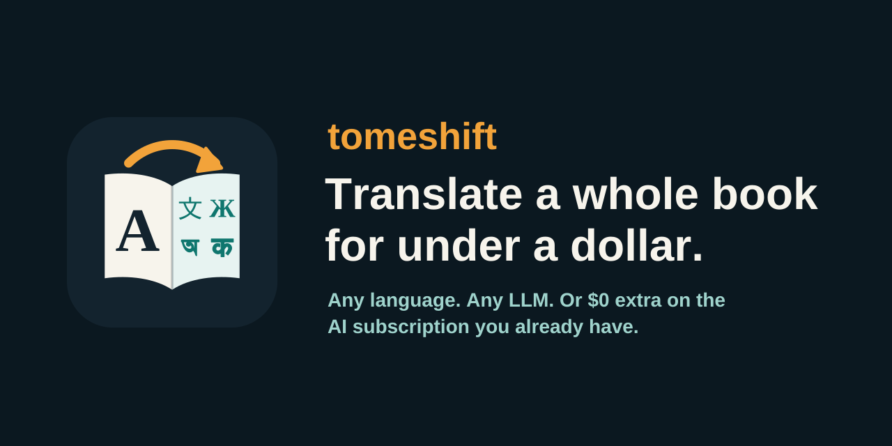

<p align="center"></p>

<p align="center">
<a href="LICENSE"></a>

</p>

# tomeshift

**Translate a whole book for under a dollar.** Any language to any language, with any LLM, or at no extra cost on the AI subscription you already have.

- **Use what you already pay for.** Run on Claude Code, Antigravity, OpenCode, Codex or Gemini CLI subscriptions at no extra cost, or on a pay-per-token API (Gemini, any OpenAI-compatible server, Anthropic).
- **The LLM only translates.** Extraction, cleanup, chunking, checks and EPUB building are plain Python and cost nothing.
- **Survives limits.** It shows live progress, pauses when a usage or rate limit hits, and continues on its own when the limit resets. You can kill it and re-run it at any time; finished chunks are never redone.
- **One file, one dependency** (`pymupdf`, for PDFs).

```
███████████░░░░░░░░░░░░░░  44.0%  66,120/150,300 words  PAUSED (limit) until 15:01  ETA 2:10:00
```

## What a 500-page book costs

That's about 150,000 words: roughly 200k input tokens and 250k–400k output tokens, depending on the target language.

| How you run it | Approx. cost |
|---|---|
| Claude Code / Codex / Gemini CLI / Antigravity subscription | **$0 extra** (uses your plan's quota) |
| OpenCode free models, or a local model via Ollama | **$0** |
| `gemini-api` with Gemini 2.5 Flash-Lite | **~$0.20** |
| `openai-api` with GPT-4o-mini | **~$0.30** |
| `gemini-api` with Gemini 2.5 Flash (higher quality) | ~$1 |

Estimates use published list prices at the time of writing plus ~10% for retries. Check your provider's current pricing. Pick the cheapest model whose 10-page sample you're happy with.

## Quick start

```bash
# run without installing (needs uv: https://docs.astral.sh/uv/)
uvx --from git+https://github.com/Hasib105/tomeshift tomeshift --help

# or install it
pip install git+https://github.com/Hasib105/tomeshift

tomeshift prep book.pdf -p mybook --from en --lang bn   # split + clean -> mybook/chunks/
tomeshift glossary -p mybook                    # one call -> mybook/glossary.json (edit it!)
tomeshift run -p mybook -j 3                    # translate (Claude Code by default)
tomeshift build -p mybook --title "My Book"     # -> mybook/book_bn.md + book_bn.epub
```

Running from a clone: `./tomeshift.py ...` (uv installs `pymupdf` automatically).

## Backends

Pick one with `--agents`. The first one listed is the main translator.

| Backend | What it runs | Cost |
|---|---|---|
| `claude` | `claude -p` with its default prompt, tools, MCP and skills switched off | your Claude plan |
| `agy` | Antigravity CLI, `agy -p` | your Google plan |
| `opencode` | `opencode run`; works with its free models | free / your plan |
| `codex` | `codex exec -` | your ChatGPT plan |
| `gemini` | Gemini CLI, `gemini -p` | free tier / plan |
| `cmd` | any command that reads the prompt on stdin: `TOMESHIFT_CMD="llm -m gpt-4o-mini"` | depends |
| `gemini-api` | Gemini REST API (`GEMINI_API_KEY`) | per token |
| `openai-api` | any OpenAI-compatible API (`OPENAI_API_KEY`, `OPENAI_BASE_URL`): OpenAI, OpenRouter, DeepSeek, Groq, local Ollama/vLLM | per token / free locally |
| `anthropic-api` | Anthropic Messages API (`ANTHROPIC_API_KEY`) | per token |

Choose a model with `--model` (for example `haiku`, `sonnet`, `gemini-3.8-flash-low`, `gemini-2.5-flash-lite`, `deepseek-chat`).

```bash
tomeshift run -p mybook --agents claude --model sonnet
tomeshift run -p mybook --agents gemini-api --model gemini-2.5-flash-lite -j 8
OPENAI_BASE_URL=https://openrouter.ai/api/v1 tomeshift run -p mybook --agents openai-api --model deepseek/deepseek-chat
tomeshift run -p mybook --agents claude,agy --fallback   # use agy while Claude is limited
```

## How it keeps cost down

1. **Free work first.** Text extraction, header/footer and page-number removal, de-hyphenation, paragraph repair and chapter-aware chunking are all done in Python.
2. **Only the needed glossary.** Names and terms are extracted once into `glossary.json`. Each chunk is sent only the entries it actually contains.
3. **Tiny prompts for agents.** Claude Code's large default system prompt, tools, MCP servers and skills are switched off, and every agent runs in an empty directory so it doesn't load your `CLAUDE.md`/`AGENTS.md`.
4. **No full second pass.** Every chunk is checked automatically: right script, little leftover English, sane length ratio, paragraphs intact, glossary followed. Only failing chunks are retried, with the reason included. Anything still failing is listed in `review.txt` for you.
5. **Parallel-safe context.** Each chunk gets the previous chunk's last paragraphs (the source text) as context, so chunks can run in parallel without losing continuity.

A 500-page book is about 150k words, or roughly 60 chunks at the default size of 2,500 words.

## Pausing and resuming

- Limit messages from the CLIs ("usage limit reached", "429", "quota", "try again in 2h", "resets 3pm") and HTTP 429 / `retry-after` from APIs are detected.
- If a reset time is given, tomeshift sleeps until then. Otherwise it probes after 10, 20, 40 and then every 60 minutes.
- Progress is written to `PROJECT/progress.json`. `tomeshift status -p mybook` shows it from anywhere.
- `--notify send-telegram` (or any command) receives one message on pause and one on finish.
- Run it inside `tmux`/`nohup` and leave it alone. If the machine reboots, run the same command again.

## Project folder

```
mybook/
  chunks/0001.md ...   source chunks (edit freely before running)
  out/0001.md ...      translations (delete one to redo it)
  glossary.json        English -> target terms (edit before `run`)
  TRANSLATE.md         optional: your own instructions for this book
  manifest.json  progress.json  run.log  review.txt
  book_bn.md  book_bn.epub
```

## Languages

Any pair works: `--from` sets the source language (default `en`), `--lang` the target (default `bn`).

Built-in codes are `en bn hi ur ar ta ne ru zh ja es fr de pt id`. These get extra checks: the output must be in the target script, little source text may be left, and the length ratio must be sane.

Any other language works by name, e.g. `--lang Swahili`. It still gets paragraph and glossary checks; only the script check is skipped. To add a language properly, add one line to `LANGS` in `tomeshift.py`.

```bash
tomeshift prep roman.epub -p roman --from fr --lang en
tomeshift prep upanyas.pdf -p upanyas --from bn --lang en
```

## Notes

- No Rust/C++ needed: preparing a 180,000-word book takes 0.13 s in Python. Almost all of the run time is spent waiting for the LLM, so speed comes from `-j` (parallel chunks) and faster models.
- Scanned PDFs need OCR first (e.g. `ocrmypdf in.pdf out.pdf`).
- Subscription plans are meant for personal use. Check your provider's terms before doing large unattended runs.
- Translating a copyrighted book for yourself is one thing. Publishing the translation needs the rights holder's permission.

## Tests

```bash
# fast suite: limit parsing, output checks, full run against a mock API (no keys needed)
uv run --no-project --with pymupdf python tests/test_tomeshift.py -v

# slow: limit -> pause -> auto-resume through the CLI path, with a fake agent (~3 minutes)
rm -f /tmp/tomeshift-fake-count
./tomeshift.py prep samples/alice.txt -p projects/t --words 150
TOMESHIFT_CMD="$PWD/tests/fake_agent.sh" ./tomeshift.py run -p projects/t --agents cmd -j 1

# API path with 429 handling, against a local mock
python3 tests/mock_openai.py 8765 &
./tomeshift.py prep samples/alice.txt -p projects/api --words 150
OPENAI_BASE_URL=http://127.0.0.1:8765/v1 ./tomeshift.py run -p projects/api --agents openai-api
```

## Contributing

Issues and pull requests are welcome; see [CONTRIBUTING.md](CONTRIBUTING.md). New backends, languages and limit-message patterns are the easiest places to start.

## License

[MIT](LICENSE). Free to use, change and redistribute, including commercially. `samples/alice.txt` is from *Alice's Adventures in Wonderland* (1865, public domain).
