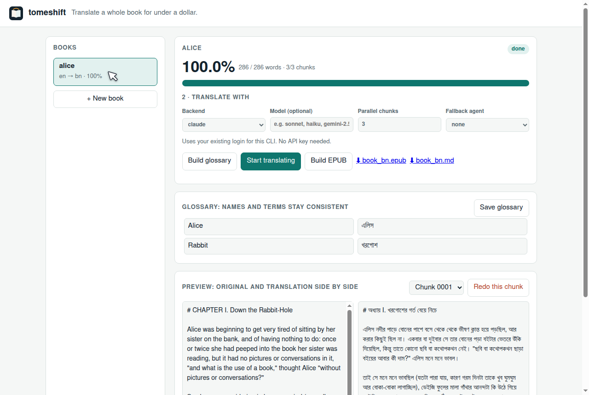

<p align="center">
  
</p>

<h1 align="center">tomeshift</h1>

<p align="center"><b>Translate a whole book for under a dollar.</b><br>
Any language to any language. Any LLM, or $0 extra on the AI subscription you already have.</p>

<p align="center">
  <a href="https://github.com/Hasib105/tomeshift/actions/workflows/ci.yml"></a>
  <a href="https://github.com/Hasib105/tomeshift/actions/workflows/codeql.yml"></a>
  <a href="https://github.com/astral-sh/ruff"></a>
  <a href="LICENSE"></a>
  
  
</p>

<p align="center">
  <a href="#use-it-from-your-ai-coding-agent">Agent skill</a> ·
  <a href="#use-the-web-ui">Web UI</a> ·
  <a href="#use-the-cli">CLI</a> ·
  <a href="#what-a-500-page-book-costs">Costs</a> ·
  <a href="#backends">Backends</a>
</p>

<p align="center"></p>

tomeshift turns a **PDF, EPUB, DOCX, TXT or Markdown** book into a translated **EPUB, DOCX and Markdown**.

- **EPUBs keep their original layout.** Only the text is swapped: images, CSS, fonts, footnotes, links, tables and code blocks stay exactly as they were. The title, description, table of contents and image alt text are translated too.
- **Bilingual books.** `--layout bilingual` keeps each original paragraph followed by its translation, which is good for language learners.

- **Use what you already pay for.** It drives Claude Code, Codex, Gemini CLI, OpenCode or Antigravity at no extra cost, or a pay-per-token API (Gemini, any OpenAI-compatible server, Anthropic).
- **The LLM only translates.** Extraction, cleanup, chunking, checks and EPUB building are plain Python and cost nothing.
- **Survives limits.** It shows live progress, pauses when a usage or rate limit hits, and continues on its own when the limit resets. You can kill it and re-run it at any time; finished chunks are never redone.
- **Consistent names.** A glossary you can edit keeps every character, place and term translated the same way across 500 pages.
- **Small.** Three Python files, one dependency (`pymupdf`, for PDFs).

```
███████████░░░░░░░░░░░░░░  44.0%  66,120/150,300 words  PAUSED (limit) until 15:01  ETA 2:10:00
```

## What a 500-page book costs

A 500-page book is about 150,000 words. That's roughly **200k input tokens** and **250k–400k output tokens**, depending on the target language. Models and prices change often, so here are price *tiers* rather than model names:

| How you run it | Approx. cost |
|---|---|
| A coding-agent subscription you already have (Claude Code, Codex, Gemini CLI, Antigravity…) | **$0 extra**, uses your plan's quota |
| Free hosted models (e.g. OpenCode's free tier) or a local model (Ollama, vLLM) | **$0** |
| API, budget tier ("lite" / "mini" / "flash"-class models) | **~$0.10–0.30** |
| API, mid tier (the provider's standard model) | **~$1–3** |
| API, top tier (flagship models) | ~$5–30 |

**Work it out for any model:** cost ≈ input tokens × input price + output tokens × output price. Output is most of the bill, so compare models on their *output* price per million tokens. Add ~10% for retries. Translate a 10-page sample with two or three models and use the cheapest one you're happy with.

## Use it from your AI coding agent

tomeshift ships as an agent skill. Once it's installed, just ask: *"Translate ~/Books/novel.epub into Bangla with tomeshift."* The agent prepares the book, shows you the glossary, runs the translation in the background, reports progress and builds the EPUB. It does **not** translate the book inside its own context, so your session stays fast and cheap.

**Claude Code**

```bash
/plugin install tomeshift --marketplace Hasib105/tomeshift
```

or, from a terminal:

```bash
claude plugin marketplace add Hasib105/tomeshift
claude plugin install tomeshift@tomeshift
```

**Codex, Cursor, OpenCode, Gemini CLI and other agents with skill support**

```bash
npx skills add Hasib105/tomeshift
```

**Gemini CLI extension**

```bash
gemini extensions install https://github.com/Hasib105/tomeshift
```

The skill lives at [`skills/tomeshift/SKILL.md`](skills/tomeshift/SKILL.md). You can also copy it into any agent's skills folder by hand.

## Use the web UI

```bash
uvx --from git+https://github.com/Hasib105/tomeshift tomeshift ui
```

This opens http://127.0.0.1:8787. In the page you can:

- drop in a book and pick the languages
- choose a backend and model
- edit the glossary
- start or pause the translation and watch the progress bar
- compare the original and the translation side by side, and redo any chunk with one click
- download the EPUB

It runs only on your machine, and books are stored in `./tomeshift-projects/`.

<p align="center"></p>

## Use the CLI

```bash
# run without installing (needs uv: https://docs.astral.sh/uv/)
uvx --from git+https://github.com/Hasib105/tomeshift tomeshift --help

# or install it
pip install git+https://github.com/Hasib105/tomeshift
```

```bash
tomeshift prep book.pdf -p mybook --from en --lang bn   # split + clean -> mybook/chunks/
tomeshift glossary -p mybook                            # one call -> mybook/glossary.json (edit it!)
tomeshift run -p mybook -j 3                            # translate (Claude Code by default)
tomeshift build -p mybook                               # -> mybook/book_bn.epub + .docx + .md
tomeshift build -p mybook --layout bilingual            # original + translation, paragraph by paragraph
```

Running from a clone: `./tomeshift.py ...` (uv installs `pymupdf` automatically).

## Backends

Pick one with `--agents`. The first one listed is the main translator.

| Backend | What it runs | Cost |
|---|---|---|
| `claude` | `claude -p` with its default prompt, tools, MCP and skills switched off | your Claude plan |
| `agy` | Antigravity CLI, `agy -p` | your Google plan |
| `opencode` | `opencode run`; works with its free models | free / your plan |
| `codex` | `codex exec -` | your ChatGPT plan |
| `gemini` | Gemini CLI, `gemini -p` | free tier / plan |
| `cmd` | any command that reads the prompt on stdin, e.g. `TOMESHIFT_CMD="llm -m MODEL"` | depends |
| `gemini-api` | Gemini REST API (`GEMINI_API_KEY`) | per token |
| `openai-api` | any OpenAI-compatible API (`OPENAI_API_KEY`, `OPENAI_BASE_URL`): OpenAI, OpenRouter, DeepSeek, Groq, local Ollama/vLLM | per token / free locally |
| `anthropic-api` | Anthropic Messages API (`ANTHROPIC_API_KEY`) | per token |

Choose a model with `--model`, using whatever name that CLI or API accepts today. Run `claude --help`, `agy models`, `opencode models` or your provider's model list to see them. If you leave it out, each backend uses a sensible default.

```bash
tomeshift run -p mybook --agents claude --model MODEL
tomeshift run -p mybook --agents gemini-api --model MODEL -j 8            # cheapest "lite"/"flash" tier works well
OPENAI_BASE_URL=https://openrouter.ai/api/v1 tomeshift run -p mybook --agents openai-api --model VENDOR/MODEL
tomeshift run -p mybook --agents claude,agy --fallback   # use agy while Claude is limited
```

## How it keeps cost down

1. **Free work first.** Text extraction, header/footer and page-number removal, de-hyphenation, paragraph repair and chapter-aware chunking are all done in Python.
2. **Only the needed glossary.** Names and terms are extracted once into `glossary.json`. Each chunk is sent only the entries it actually contains.
3. **Tiny prompts for agents.** Claude Code's large default system prompt, tools, MCP servers and skills are switched off, and every agent runs in an empty directory so it doesn't load your `CLAUDE.md`/`AGENTS.md`.
4. **No full second pass.** Every chunk is checked automatically: right script, little leftover English, sane length ratio, paragraphs intact, glossary followed. Only failing chunks are retried, with the reason included. Anything still failing is listed in `review.txt` for you.
5. **Parallel-safe context.** Each chunk gets the previous chunk's last two source paragraphs inside a `<context>` tag, so chunks can run in parallel without losing continuity. If the model translates the context by mistake, the check catches it and the chunk is retried.

A 500-page book is about 150k words, or roughly 60 chunks at the default size of 2,500 words.

## Pausing and resuming

- Limit messages from the CLIs ("usage limit reached", "429", "quota", "try again in 2h", "resets 3pm") and HTTP 429 / `retry-after` from APIs are detected.
- If a reset time is given, tomeshift sleeps until then. Otherwise it probes after 10, 20, 40 and then every 60 minutes.
- Progress is written to `PROJECT/progress.json`. `tomeshift status -p mybook` shows it from anywhere.
- `--notify send-telegram` (or any command) receives one message on pause and one on finish.
- Run it inside `tmux`/`nohup` and leave it alone. If the machine reboots, run the same command again.

## Project folder

```
mybook/
  chunks/0001.md ...   source chunks (edit freely before running)
  out/0001.md ...      translations (delete one to redo it)
  glossary.json        English -> target terms (edit before `run`)
  TRANSLATE.md         optional: your own instructions for this book
  manifest.json  progress.json  run.log  review.txt
  source.epub  segments.json   EPUB mode: the original book and where each segment lives
  book_bn.epub  book_bn.docx  book_bn.md       (+ book_bn_bilingual.* with --layout bilingual)
```

## Formats

| Input | How it's handled |
|---|---|
| **EPUB** | Translated **in place**: each paragraph becomes a numbered segment, and inline formatting becomes markers (`⟦1⟧very⟦/1⟧`) that the model keeps. The original EPUB is rebuilt with only the text changed. Use `prep --flat` to rebuild from plain text instead. |
| **DOCX** | Headings and italics are kept. Output is a new EPUB, DOCX and Markdown. |
| **PDF** | Text PDFs. Running headers, footers and page numbers are removed. Scanned PDFs need OCR first (`ocrmypdf`). |
| **TXT / Markdown** | Chapters are detected from headings. |

If a model breaks the markers in a paragraph, the automatic check retries it. If it's still broken, that paragraph keeps the translated text but loses its inline formatting, and images and footnote links are never dropped. The build reports how many paragraphs that happened to.

## Languages

Any pair works: `--from` sets the source language (default `en`), `--lang` the target (default `bn`).

Built-in codes are `en bn hi ur ar ta ne ru zh ja es fr de pt id`. These get extra checks: the output must be in the target script, little source text may be left, and the length ratio must be sane.

Any other language works by name, e.g. `--lang Swahili`. It still gets paragraph and glossary checks; only the script check is skipped. To add a language properly, add one line to `LANGS` in `tomeshift.py`.

```bash
tomeshift prep roman.epub -p roman --from fr --lang en
tomeshift prep upanyas.pdf -p upanyas --from bn --lang en
```

## Notes

- No Rust/C++ needed: preparing a 180,000-word book takes 0.13 s in Python. Almost all of the run time is spent waiting for the LLM, so speed comes from `-j` (parallel chunks) and faster models.
- Scanned PDFs need OCR first (e.g. `ocrmypdf in.pdf out.pdf`).
- Subscription plans are meant for personal use. Check your provider's terms before doing large unattended runs.
- Translating a copyrighted book for yourself is one thing. Publishing the translation needs the rights holder's permission.

## Tests

```bash
uv run --no-project --with pymupdf --with pytest pytest      # 18 tests, ~7 s, no API keys needed
uvx ruff check . && uvx ruff format --check . && uvx mypy tomeshift.py tomeshift_ui.py tomeshift_epub.py
```

CI runs these on Linux and macOS with Python 3.10–3.13. It also checks the plugin manifests and installs the built wheel. A slower manual test of the CLI pause/resume path uses a fake agent:

```bash
rm -f /tmp/tomeshift-fake-count
./tomeshift.py prep samples/alice.txt -p projects/t --words 150
TOMESHIFT_CMD="$PWD/tests/fake_agent.sh" ./tomeshift.py run -p projects/t --agents cmd -j 1   # ~3 min
```

## Contributing

Issues and pull requests are welcome; see [CONTRIBUTING.md](CONTRIBUTING.md) and the [Code of Conduct](CODE_OF_CONDUCT.md). Report security problems privately (see [SECURITY.md](SECURITY.md)). New backends, languages and limit-message patterns are the easiest places to start.

## License

[MIT](LICENSE). Free to use, change and redistribute, including commercially. `samples/alice.txt` is from *Alice's Adventures in Wonderland* (1865, public domain).
